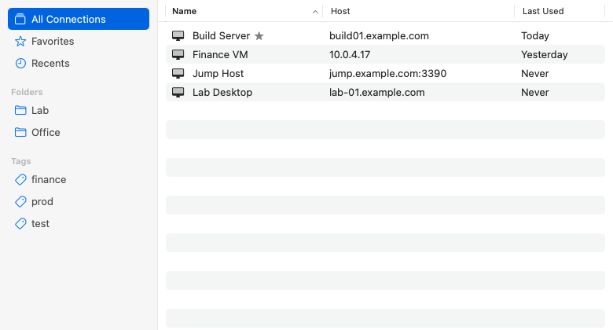
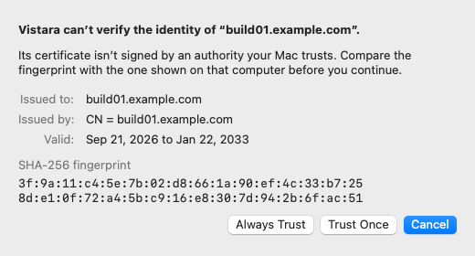

# Vistara

A Mac app for connecting to Windows computers and other Remote Desktop (RDP)
servers. FreeRDP does the protocol work; everything you see and touch is a
native Mac app.

<picture>
  <source media="(prefers-color-scheme: dark)" srcset="docs/images/library-dark.png">
  
</picture>

Vistara keeps your connections in one window, with folders, tags, and
favorites. Each session gets its own window that the remote desktop fills, at
full Retina sharpness. It shares the clipboard, sound, and the folders you
choose, and reconnects when your network drops. It follows the Mac's
conventions: Command shortcuts stay with your Mac, and the keyboard is never
trapped in a session.

Vistara is new and has not had a release yet. It has been tested against
FreeRDP's own server; checking it against Windows hosts is still to come.

## Install

Vistara needs macOS 14 or later, on Apple silicon or Intel.

Signed downloads will appear on the
[Releases](https://github.com/sysmike/vistara/releases) page: open the DMG and
drag Vistara to Applications. Until the first release, build it from source
as described in [Developing Vistara](docs/DEVELOPING.md).

## Your first connection

1. Open Vistara. Choose **File > New Connection…** (Command-N), type the
   computer's name or address, and click **Add**.
2. Double-click the connection. Enter your user name and password; turn on
   *Remember this password in my keychain* if you want to skip this step next
   time.
3. Vistara shows the computer's certificate the first time. Compare its
   fingerprint with the one on the computer, then click **Always Trust** or
   **Trust Once**.

<picture>
  <source media="(prefers-color-scheme: dark)" srcset="docs/images/certificate-dark.png">
  
</picture>

The remote desktop opens in its own window and follows its size. Command
shortcuts stay with your Mac; Command-C, V, X, Z and the other editing
shortcuts reach the remote computer as their Control equivalents. Use
**Session > Send Ctrl+Alt+Del** (Control-Option-Delete) to sign in or lock.
Closing the window disconnects; your session keeps running on the computer,
and **Session > Reconnect** (Command-R) brings you back.

The [user guide](docs/USER-GUIDE.md) covers everything else: the keyboard,
the clipboard, sound, shared folders, `.rdp` files, Settings, and known
limits. In the app, it is under **Help > Vistara Help**.

## Security

- Passwords are kept only in your login keychain, and only when you ask. They
  never appear in Vistara's files, logs, or exported `.rdp` files.
- Certificates are always checked. An unknown one is shown with its
  fingerprint before you trust it; a changed one is a warning, never a silent
  reconnect.
- Network Level Authentication and TLS 1.2 or newer are the default.
- Your Mac shares only what a connection allows: the clipboard while its
  window is in front, sound, and the folders you chose, each one read-only if
  you like.
- Vistara runs in the App Sandbox with the hardened runtime. Its logs replace
  host names, user names, and passwords with placeholders.

The details are in [Security posture](docs/ARCHITECTURE.md#security-posture).

## More

- [User guide](docs/USER-GUIDE.md)
- [Developing Vistara](docs/DEVELOPING.md): building, tests, logs
- [Architecture](docs/ARCHITECTURE.md) and [interface specification](docs/DESIGN.md)
- [Releasing](docs/RELEASING.md) and [updating FreeRDP](docs/UPDATING-FREERDP.md)
- [Issues](https://github.com/sysmike/vistara/issues), grouped by milestone

## License

[MIT](LICENSE)
