# Vistara user guide

Vistara connects your Mac to Windows computers and other Remote Desktop (RDP)
servers. This guide covers everything it does; the [README](../README.md) has
the short version.

- [Your connections](#your-connections)
- [Connecting](#connecting)
- [The session window](#the-session-window)
- [Keyboard](#keyboard)
- [Clipboard, sound, and shared folders](#clipboard-sound-and-shared-folders)
- [When the connection drops](#when-the-connection-drops)
- [Importing and exporting .rdp files](#importing-and-exporting-rdp-files)
- [Settings](#settings)
- [Privacy and security](#privacy-and-security)
- [Known limits](#known-limits)
- [Troubleshooting](#troubleshooting)

## Your connections

The Connections window (Window > Connections, Command-0) lists the computers
you connect to. The sidebar shows All Connections, Favorites, Recents (the 20
used last), your folders, and your tags. The search field filters by name,
computer, user, and tag as you type.

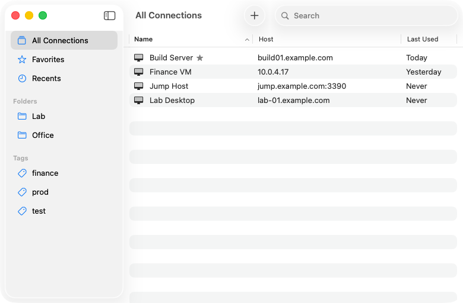

| To | Do |
| --- | --- |
| Add a connection | File > New Connection… (Command-N), or the + button |
| Connect | Double-click it, press Return, or File > Connect (Command-O) |
| Change it | Edit > Edit Connection… (Command-I) |
| Copy it | Edit > Duplicate (Command-D) |
| Delete it | Edit > Delete Connection (Command-Delete); Edit > Undo brings it back |
| Make a folder | File > New Folder (Shift-Command-N) |
| File it | Drag it onto a folder or onto Favorites, or Edit > Move to Folder |

Every command is also in the connection's context menu.

### The connection editor

Only the computer's name or address is required. Everything else has a
sensible default, and new connections start with the defaults you choose in
Settings > General.

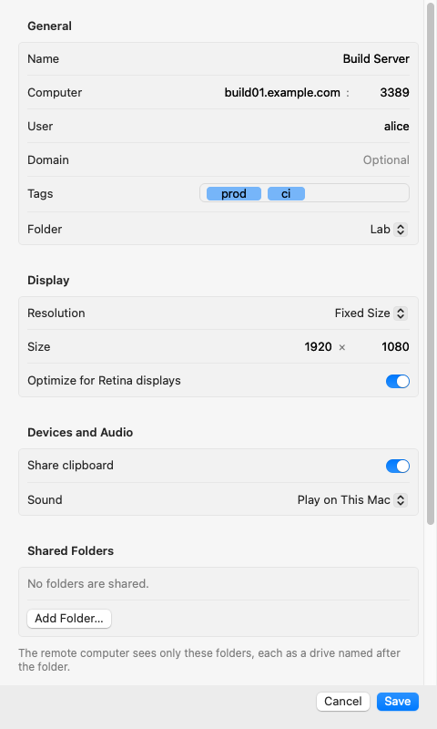

- **General**: a name, the computer (with a port if it isn't 3389), the user
  name and domain to suggest when signing in, a folder, and tags. You can type
  `DOMAIN\user` in the User field.
- **Gateway**: whether the connection goes through a Remote Desktop Gateway,
  which passes it on to a computer inside its network. *Never*, the default,
  connects directly. *Always* asks for the gateway's address (add a port
  after a colon if it isn't 443) and how to sign in to it: as the computer's
  account, or as another account with its own user name and domain.
- **Display**: *Match Window* resizes the remote desktop to fill the window;
  *Keep Size, Scale to Fit* keeps the desktop's size and scales it; *Fixed
  Size* asks for a size you choose. *Optimize for Retina displays* gives the
  desktop every pixel and tells Windows to scale it up, so text stays sharp.
  *Displays: All Displays* spreads the remote desktop across every display of
  your Mac; see below.
- **Devices and Audio**: whether to share the clipboard, and where sound
  plays.
- **Shared Folders**: Mac folders the remote computer may use. See below.
- **Security**: whether to reconnect when the connection drops, whether to
  require Network Level Authentication, and how to treat certificates. A
  choice that weakens security says so beneath it.

There is no password field. Vistara asks for the password when you connect.

<picture>
  <source media="(prefers-color-scheme: dark)" srcset="images/editor-gateway-dark.png">
  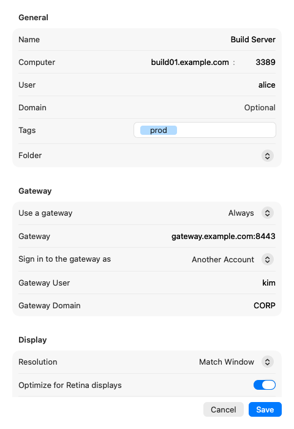
</picture>

## Connecting

### Signing in

The first time, Vistara asks for your user name and password. Turn on
*Remember this password in my keychain* to sign in without asking next time.
The password is saved in your login keychain and nowhere else. If the
computer refuses it, the same sheet comes back and says so.

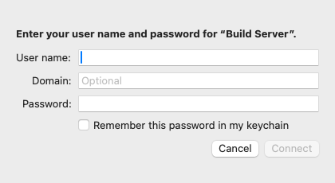

Through a gateway that signs in as the computer's account, the same sheet
asks once for both. One that signs in as another account asks first, in a
sheet of its own that names the gateway and the connection:

<picture>
  <source media="(prefers-color-scheme: dark)" srcset="images/gateway-credentials-dark.png">
  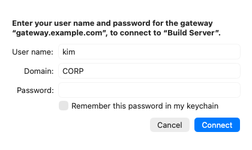
</picture>

A remembered gateway password belongs to the gateway and that user name, so
every connection through the same gateway uses it.

A gateway may show a message before it connects: a notice, or terms to
accept. **Cancel** doesn't connect.

<picture>
  <source media="(prefers-color-scheme: dark)" srcset="images/gateway-consent-dark.png">
  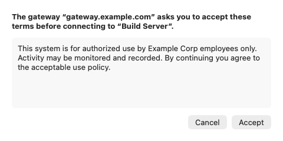
</picture>

### Certificates

Every Remote Desktop computer proves its identity with a certificate. Windows
computers usually make their own, which your Mac has never seen, so the first
connection asks whether to trust it:

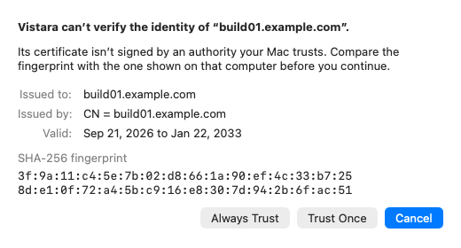

Compare the SHA-256 fingerprint with the one on the remote computer (on
Windows, in the Remote Desktop certificate's details). Then:

- **Always Trust** remembers the certificate for this computer. Next time
  Vistara connects without asking, as long as the certificate is the same.
- **Trust Once** connects this time and asks again next time.
- **Cancel** doesn't connect.

Certificates your Mac already trusts, for example ones issued by your
company's certificate authority, are accepted without a question.

A gateway has a certificate too. Most gateways have one your Mac trusts;
otherwise the same sheet asks about it first, naming the gateway, and
**Always Trust** remembers it for the gateway's address. Settings > Security
lists gateways beside computers, marked as gateways.

<picture>
  <source media="(prefers-color-scheme: dark)" srcset="images/gateway-certificate-dark.png">
  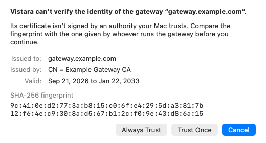
</picture>

If a computer you trusted presents a *different* certificate, Vistara warns
you before anything else happens:

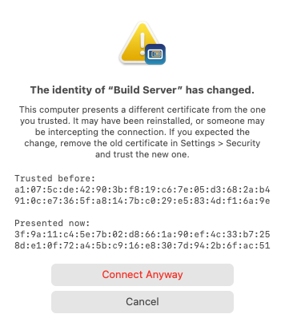

That can mean the computer was reinstalled, or that someone is intercepting
the connection. **Connect Anyway** connects once; to trust the new certificate
for good, remove the old one in Settings > Security and connect again. A
connection set to *Require a Trusted Certificate* never asks: it connects only
to certificates you or your Mac already trust.

## The session window

Each connection opens in a window of its own, titled with the connection's
name. The remote desktop fills the window and follows its size: a quarter of
a second after you stop resizing, the remote computer is asked for a desktop
that fits. View > Enter Full Screen (Control-Command-F) works as in any Mac
app.

The Session menu acts on the session in front:

| Command | Shortcut |
| --- | --- |
| Reconnect | Command-R |
| Disconnect | (closes the window) |
| Send Ctrl+Alt+Del | Control-Option-Delete |
| Send Windows Key | |

Closing the window disconnects without asking. The remote session keeps
running on the computer, so Reconnect brings you back to it. Quitting Vistara
with sessions open asks once.

Open sessions are listed in the Window menu and in Vistara's Dock menu, which
also lists your favorites.

### All displays

A connection set to *All Displays* (in the editor's Display section) opens
in full screen on every display of your Mac, as one remote desktop: Windows
sees a monitor for each display, arranged as they are in System Settings >
Displays, with its taskbar on the display that has the menu bar. The pointer
moves across them freely. Connecting, removing, or rearranging a display
during the session changes the remote desktop to match; with one display
left, the session goes on in full screen on it, and spreads out again when
you connect another.

It is still one session: closing any of its windows, or Session >
Disconnect, ends it. Leaving full screen on any display brings the session
back into one window. All Displays needs *Displays have separate Spaces* in
System Settings > Desktop & Dock; while that is off, the session uses one
display. New connections start with the choice in Settings > General.

### Tabs

Several sessions can share one window as tabs. Where a new session opens
follows your Mac's setting *Prefer tabs when opening documents* (System
Settings > Desktop & Dock): *Always* opens it as a tab of the session window
in front, *In Full Screen* does so when that window is in full screen, and
*Never* gives it a window of its own. Hold Option to do the other: File >
Connect becomes *Connect in New Tab* or *Connect in New Window*, in the
connection's context menu too, and Option-double-click or Option-Return work
the same way.

Window > Merge All Windows puts every session window into one; drag a tab
out, or choose Window > Move Tab to New Window, to give it a window of its
own again. Connecting to a computer whose session is in a tab brings that
tab to the front.

A session nobody can see, in a background tab, a minimized window, or a
window entirely covered, stays connected but asks the remote computer to stop
sending its screen, which saves network and processor time on both ends. Its
picture is complete again as soon as you look at it. Sound keeps playing.

A tab shows how its session is doing without your selecting it: a spinner
while it connects or reconnects, and a symbol once it has ended; point at the
symbol to see why. VoiceOver announces a background tab's news with the
connection's name. Shift-Command-] and
Shift-Command-[ show the next and previous tab. Control-Tab and
Control-Shift-Tab stay with the remote computer, where Windows apps use them
to switch their own tabs.

Each tab is a session of its own: closing a tab (Command-W) disconnects only
that session, and File > Close Window (Shift-Command-W) closes the window with
all its tabs. The tabs share the window's size, and a tab you bring to the
front asks its computer for that size. Only the tab in front gets your
keyboard and is offered your Mac's clipboard.

## Keyboard

While a session window is in front:

1. **macOS keeps its own shortcuts.** Command-Tab, Command-Space, Mission
   Control and the like never reach the remote computer.
2. **Command belongs to the Mac.** Every Command shortcut in Vistara's menus
   works as usual, so Command-W, Command-Q and Command-Backtick always get you
   out of a session.
3. **Editing shortcuts are translated.** Command-C, V, X, A, Z, F, S and
   Shift-Command-Z reach the remote computer as Control-C, V, and so on. Turn
   this off in Settings > Keyboard.
4. **Everything else goes to the remote computer**: Control, Option (as Alt),
   Shift, the function keys, and Tab.

Keys are sent by their position on the keyboard, and the remote computer's
keyboard layout decides what they type. When you connect, Vistara tells the
remote computer which layout your Mac uses (German, French, Japanese, and
other common ones), and a new Windows session starts with it. An account that
already has a layout of its own keeps it.

A few keys have no exact counterpart: Delete is Backspace, Forward Delete is
Delete, Help is Insert, and F13 and F14 are Print Screen and Scroll Lock.

The Windows key has no free counterpart on a Mac keyboard. Use Session > Send
Windows Key, or turn on *Use Right Command as the Windows key* in Settings >
Keyboard. Right Command then works as the Windows key, so Right Command-R
opens Run; Left Command stays with the Mac.

## Clipboard, sound, and shared folders

All three are set per connection in the editor.

**Clipboard.** With *Share clipboard* on, text copied on the remote computer
is on your Mac's clipboard right away, and text you copy on the Mac can be
pasted there. Line endings are converted. Your Mac's clipboard is offered
only while the session window is in front, and items your password manager
marks as concealed are never shared. Only text is shared, not files or
images. With the option off, nothing is shared in either direction.

**Sound.** *Play on This Mac* plays the remote computer's sound through your
Mac's current output, and follows you when you switch to headphones. *Play on
Remote Computer* leaves it there; *Off* plays it nowhere. Vistara never uses
your microphone.

**Shared folders.** Add folders with *Add Folder…*. The remote computer sees
each one as a drive named after the folder, and nothing else on your Mac.
Turn on *Read only* to let it read a folder but not change anything in it. If
you move or rename a shared folder, Vistara finds it and, from the next
connection, shows it in its new place. A folder that has been deleted, or
that Vistara cannot find any more, says so in the editor and isn't shared.

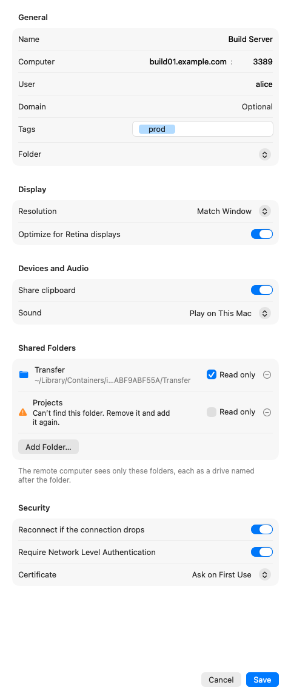

## When the connection drops

If your network goes away during a session, and *Reconnect if the connection
drops* is on, Vistara keeps the last picture, dimmed, and tries again for
about a minute. It tries at once when your Mac wakes from sleep or the network
comes back. **Reconnect Now** tries without waiting; **Cancel** stops.

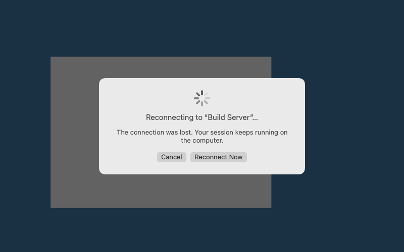

Each attempt is a new connection: the certificate is checked again, and if
the password isn't saved, you are asked for it. A session that the remote
computer, an administrator, or you ended is not reconnected. If no attempt
succeeds, the window says so and offers Reconnect.

## Importing and exporting .rdp files

- **File > Import…** adds a connection for each `.rdp` file you choose, named
  after the file. Opening an `.rdp` file from the Finder, or dropping one on
  the Connections window or the Dock icon, does the same.
- **File > Export…** writes the selected connections as `.rdp` files, in the
  format Microsoft's Remote Desktop app uses.

Passwords are never imported or exported. A notice above the list says what
an import did, including any password it left out and any line it didn't
understand.

A file's gateway comes with it. Vistara uses a gateway always or never: a
file that uses its gateway only when the computer can't be reached directly,
or not for local addresses, imports as Always, and the notice says so.

## Settings

Vistara > Settings… (Command-Comma):

- **General**: what new connections start with, and whether to ask before
  quitting with sessions open.
- **Keyboard**: editing shortcuts, and Right Command as the Windows key.
- **Security**: the certificates you chose to always trust, with their full
  fingerprints. Removing one needs no confirmation; the next connection to
  that computer simply asks again.

Vistara follows your Mac's appearance, accent colour, and accessibility
settings; it has no settings of its own for them.

## Privacy and security

- **Passwords** are kept only in your login keychain, and only when you ask.
  They never appear in Vistara's files, its logs, or exported `.rdp` files.
- **Certificates** are always checked. An unknown one is shown with its
  fingerprint before you trust it, and a changed one is a warning, never a
  silent reconnect.
- **Connections** use Network Level Authentication and TLS 1.2 or newer by
  default. Turning NLA off for an older computer is a per-connection choice,
  explained in the editor.
- **Your Mac** shares only what a connection allows: the clipboard while the
  session window is in front, sound, and the folders you chose.
- Vistara runs in the **App Sandbox** with the hardened runtime. It contacts
  only the computers you connect to; Help opens this guide in your browser.

For the details, see [Security posture](ARCHITECTURE.md#security-posture) in
the architecture document.

## Known limits

Vistara is new. It does not yet support:

- using only some of your displays (All Displays uses every one);
- RemoteApp, smart cards, printers, or USB devices;
- copying files or images through the clipboard (text only);
- the microphone (by design for now);
- keeping sessions across a restart of Vistara.

The remote desktop is a picture of the remote screen. VoiceOver reads
Vistara's own windows, menus, and messages, and announces when a session
connects or ends, but it cannot read what is on the remote screen; use the
remote computer's own screen reader for that.

## Troubleshooting

When a connection fails, the window says what happened and what to try, with
a button that does it. *Details* shows the technical cause, and *Copy Details*
copies it for a bug report.

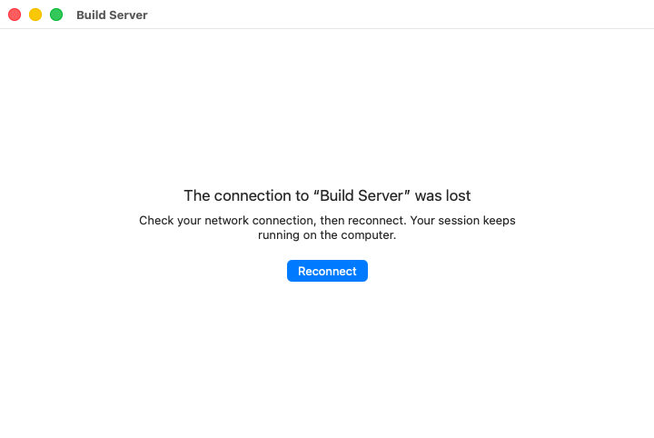

To see more, collect Vistara's log while you reproduce the problem:

```bash
log stream --level debug --predicate 'subsystem == "io.github.sysmike.vistara"'
```

Host names, user names, domains, passwords, and IP addresses are replaced
with placeholders before anything is logged, so the output is meant to be
safe to share. Read it before you post it anyway.

Report problems in the [issues](https://github.com/sysmike/vistara/issues).
